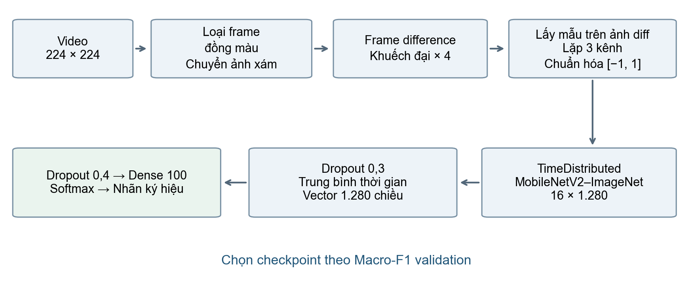
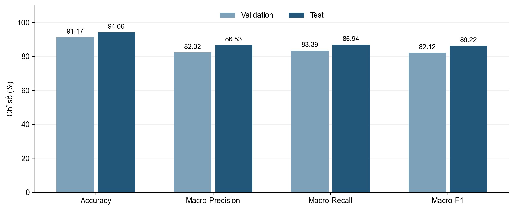
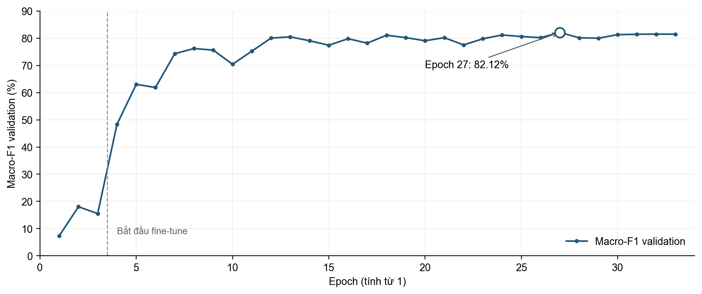
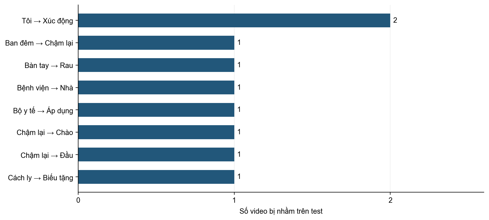

# NHẬN DẠNG NGÔN NGỮ KÝ HIỆU VIỆT NAM BẰNG FRAME DIFFERENCE VÀ MOBILENETV2

## 1. MÔ TẢ PHƯƠNG PHÁP

### 1.1. Tổng quan phương pháp

Bài toán được đặt ra là nhận dạng ký hiệu rời rạc của ngôn ngữ ký hiệu Việt Nam: mỗi video chứa đúng một ký hiệu và mô hình cần gán cho video một nhãn trong 100 lớp. Ý nghĩa của một ký hiệu nằm chủ yếu ở chuyển động của tay, cánh tay và thân người theo thời gian, trong khi phần lớn nội dung ảnh như phông nền, quần áo hay khuôn mặt người ký gần như không đổi trong suốt video. Vì vậy, phương pháp được đề xuất không đưa trực tiếp ảnh RGB vào mô hình mà biểu diễn video bằng chuỗi ảnh sai khác giữa các khung hình liên tiếp (frame difference), chỉ giữ lại những vùng có thay đổi.

Phương pháp gồm ba thành phần chính. Thứ nhất, mỗi video được chuyển thành chuỗi ảnh sai khác khung hình trên ảnh xám, sau khi loại các khung hình trống. Thứ hai, 16 ảnh sai khác được lấy đều theo thời gian và đưa qua mạng tích chập MobileNetV2 được huấn luyện trước trên ImageNet; cùng một mạng được dùng chung cho mọi bước thời gian để trích xuất một vector đặc trưng 1.280 chiều cho mỗi bước. Thứ ba, 16 vector đặc trưng được tổng hợp bằng phép trung bình theo thời gian (temporal average pooling) thành một vector đại diện cho cả video, rồi đi qua một lớp kết nối đầy đủ để phân loại 100 lớp. Cách tổ chức này tương tự nhánh chuyển động trong các mạng Temporal Segment Network và two-stream: mạng 2D xử lý từng thời điểm, còn thông tin thời gian được gộp ở mức đặc trưng.

Frame difference chỉ cần một phép trừ ảnh nên rất rẻ; MobileNetV2 là mạng nhẹ, phù hợp khi phải xử lý 16 ảnh cho mỗi video. Toàn bộ mô hình chỉ có khoảng 2,39 triệu tham số.

### 1.2. Tiền xử lý video và tính ảnh sai khác khung hình

Các video trong bộ dữ liệu có khoảng 30 khung hình (trung vị 30, ít nhất 16), tốc độ khoảng 12 khung hình/giây. Mỗi khung hình được thu nhỏ về 224 × 224 bằng nội suy INTER_AREA. Một số video có khung hình đồng màu, thường là khung đen ở đầu hoặc cuối đoạn quay. Một khung hình được xem là trống khi độ lệch chuẩn giá trị điểm ảnh của cả ba kênh màu đều không vượt quá 1 (trên thang 0–255). Các khung này bị loại khỏi chuỗi trước khi tính chuyển động; nếu giữ lại, cặp khung "ảnh trống → ảnh có người" sẽ sinh ra một ảnh sai khác rất lớn nhưng không phản ánh động tác ký hiệu. Trên toàn bộ 3.866 video, có 754 video chứa khung trống với tổng cộng 9.245 khung bị loại.

Các khung còn lại được chuyển sang ảnh xám. Gọi Gₜ là ảnh xám tại khung t, ảnh sai khác được tính trên các cặp khung liên tiếp:

    Dₜ = |Gₜ − Gₜ₋₁|,   t = 1, …, N − 1.

Với N khung hợp lệ, video cho ra N − 1 ảnh sai khác (trung vị 29). Giá trị tuyệt đối làm nổi bật những điểm ảnh có cường độ thay đổi, chủ yếu tại vùng bàn tay và cánh tay đang di chuyển, trong khi phông nền tĩnh gần như bằng 0. Các ảnh sai khác được tính một lần, lưu dưới dạng uint8 trong tệp .npz nén và dùng lại qua mọi epoch.

Do chuyển động giữa hai khung thường nhỏ, giá trị Dₜ phần lớn nằm gần 0. Trước khi đưa vào mạng, ảnh sai khác được khuếch đại 4 lần, cắt ở 255 và chuẩn hóa về khoảng [−1, 1]:

    Xₜ = 2 × min(4·Dₜ, 255) / 255 − 1.

Ảnh một kênh sau đó được lặp thành ba kênh giống nhau để tương thích với đầu vào RGB của MobileNetV2; khoảng [−1, 1] cũng chính là khoảng chuẩn hóa mà MobileNetV2 sử dụng khi huấn luyện trên ImageNet.

### 1.3. Lấy mẫu thời gian và tăng cường dữ liệu

Số ảnh sai khác khác nhau giữa các video, nên mỗi video được đưa về độ dài cố định T = 16 bước. Với n ảnh sai khác, chỉ số bước thứ k được lấy đều trên toàn chuỗi:

    iₖ = clip(round(linspace(0, n − 1, 16)ₖ × s), 0, n − 1),   k = 0, …, 15.

Khi đánh giá, s = 1 nên 16 bước được trải đều từ đầu đến cuối video. Khi huấn luyện, s được lấy ngẫu nhiên trong [0,9; 1,1] để mô phỏng việc người ký thực hiện nhanh hoặc chậm hơn một chút. Nếu video có ít hơn 16 ảnh sai khác, một số chỉ số được lặp lại, nhờ đó mọi video đều cho ra tensor cùng kích thước.

Ngoài co giãn thời gian, dữ liệu huấn luyện còn được tăng cường bằng cắt ngẫu nhiên theo không gian: một vùng vuông chiếm 85–100% diện tích ảnh được chọn ngẫu nhiên rồi phóng lại về 224 × 224. Vị trí cắt được giữ giống nhau cho cả 16 bước của một video để không tạo ra chuyển động giả giữa các bước. Không sử dụng tăng cường màu sắc vì đầu vào là ảnh sai khác cường độ, không còn thông tin màu. Đầu vào cuối cùng của mô hình có kích thước B × 16 × 224 × 224 × 3, với B là kích thước batch.

### 1.4. Kiến trúc mô hình

Mô hình gồm ba khối: bộ trích xuất đặc trưng không gian, khối tổng hợp theo thời gian và bộ phân loại.

**Bộ trích xuất đặc trưng.** MobileNetV2 với trọng số huấn luyện trước trên ImageNet được dùng làm backbone, bỏ lớp phân loại gốc và thêm global average pooling theo không gian. MobileNetV2 được xây dựng từ các khối inverted residual với tích chập depthwise separable, nên có số tham số và phép tính thấp so với các mạng như ResNet. Backbone được bọc trong lớp TimeDistributed: cùng một bộ trọng số được áp dụng độc lập cho từng ảnh sai khác, tạo ra 16 vector đặc trưng fₜ ∈ ℝ¹²⁸⁰. Việc dùng chung trọng số giữa các bước giúp số tham số không tăng theo T. Dropout 0,3 được áp dụng lên chuỗi đặc trưng.

**Tổng hợp theo thời gian.** Vector đại diện cho cả video được tính bằng trung bình các đặc trưng:

    h = (1/16) · Σₜ fₜ.

Phép trung bình không thêm tham số học và tổng hợp thông tin từ mọi thời điểm của động tác.

**Bộ phân loại.** Vector h đi qua Dropout 0,4 và một lớp Dense 100 đầu ra. Khi dự đoán, softmax được áp dụng lên logits và nhãn có xác suất lớn nhất được chọn.

| Khối | Thành phần | Kích thước đầu ra |
|---|---|---|
| Đầu vào | 16 ảnh sai khác, 3 kênh, giá trị [−1, 1] | B × 16 × 224 × 224 × 3 |
| Trích xuất đặc trưng | TimeDistributed(MobileNetV2–ImageNet) + Dropout 0,3 | B × 16 × 1.280 |
| Tổng hợp thời gian | GlobalAveragePooling1D | B × 1.280 |
| Phân loại | Dropout 0,4 + Dense 100 (float32) | B × 100 |

### 1.5. Chiến lược huấn luyện

Bộ dữ liệu mất cân bằng giữa các lớp: trong tập huấn luyện, lớp ít nhất có 4 video còn lớp nhiều nhất có 59 video. Để mỗi lớp được học với tần suất tương đương, mỗi epoch lấy N mẫu có hoàn lại từ N video huấn luyện, với xác suất chọn mỗi video tỷ lệ với 1/n_c, trong đó n_c là số video của lớp chứa video đó. Hàm mất mát là categorical cross-entropy với label smoothing 0,1 nhằm giảm việc mô hình quá tự tin trên các lớp ít mẫu. Bộ tối ưu là AdamW với weight decay 10⁻⁴.

Quá trình huấn luyện gồm hai giai đoạn. Ở giai đoạn khởi động (3 epoch), backbone MobileNetV2 được đóng băng và chỉ bộ phân loại được cập nhật với learning rate 10⁻³; giai đoạn này giúp lớp Dense mới khởi tạo hội tụ trước, tránh gradient lớn phá hỏng trọng số ImageNet. Ở giai đoạn fine-tune (tối đa 30 epoch), toàn bộ backbone được mở để học với learning rate khởi đầu 10⁻⁴, giảm dần theo lịch CosineDecay. Các lớp Batch Normalization vẫn được giữ đóng băng trong cả hai giai đoạn, vì batch nhỏ và các ảnh trong cùng một video có tương quan mạnh sẽ làm thống kê batch không đáng tin cậy.

Cuối mỗi epoch, trọng số được lưu khi Macro-F1 validation đạt giá trị cao nhất mới; nếu không cải thiện trong 8 epoch liên tiếp thì dừng sớm. Trọng số tốt nhất được nạp lại để đánh giá trên tập test. Mô hình được cài đặt bằng TensorFlow/Keras, huấn luyện với batch size 4 và mixed precision trên GPU Tesla T4.

### 1.6. Phương pháp đánh giá

Các chỉ số gồm Top-1 Accuracy, Macro-Precision, Macro-Recall và Macro-F1, trong đó các chỉ số macro là trung bình không trọng số trên đủ 100 lớp. Macro-F1 là chỉ số chính vì mỗi lớp đóng góp ngang nhau, phản ánh đúng hơn chất lượng trên các lớp ít mẫu. Thời gian suy luận cho một video cũng được đo.

## 2. KẾT QUẢ THỰC NGHIỆM

### 2.1. Dữ liệu thực nghiệm

Bộ dữ liệu gồm 3.866 video thuộc 100 lớp, được chia thành ba tập huấn luyện, validation và test; cả ba tập đều có đủ 100 lớp. Thống kê số mẫu như sau:

| Tập dữ liệu | Số video | Tỷ lệ tổng số | Số lớp | Ít nhất/lớp | Nhiều nhất/lớp | Trung bình/lớp |
|---|---:|---:|---:|---:|---:|---:|
| Train | 3.077 | 79,59% | 100 | 4 | 59 | 30,77 |
| Validation | 385 | 9,96% | 100 | 1 | 7 | 3,85 |
| Test | 404 | 10,45% | 100 | 1 | 8 | 4,04 |

Dữ liệu chênh lệch đáng kể về số mẫu giữa các lớp: trong tập train, lớp ít nhất chỉ có 4 video còn lớp nhiều nhất có 59 video. Tập validation có 26 lớp và tập test có 23 lớp chỉ có một mẫu. Do đó, chỉ một lỗi ở các lớp này đã có thể làm Recall và F1 của cả lớp bằng 0, dù chỉ làm thay đổi nhỏ Accuracy toàn tập.

### 2.2. Thiết lập thực nghiệm

| Tham số | Giá trị |
|---|---|
| Biểu diễn đầu vào | Frame difference trên ảnh xám; hệ số khuếch đại 4 |
| Số lớp / số bước thời gian | 100 / 16 |
| Kích thước đầu vào mỗi bước | 224 × 224 × 3 |
| Backbone / tổng hợp thời gian | MobileNetV2–ImageNet / Temporal average pooling |
| Tăng cường dữ liệu | Co giãn thời gian 0,9–1,1; cắt ngẫu nhiên 85–100% diện tích |
| Batch size / seed | 4 / 42 |
| Khởi động / fine-tune tối đa | 3 epoch / 30 epoch |
| Bộ tối ưu / weight decay | AdamW / 10⁻⁴ |
| Learning rate khởi động / fine-tune | 10⁻³ / 10⁻⁴ với CosineDecay |
| Label smoothing | 0,1 |
| Tiêu chí checkpoint / patience | Macro-F1 validation / 8 epoch |
| Thiết bị | GPU NVIDIA Tesla T4 (Kaggle), mixed precision |

Các chỉ số trong báo cáo được tính lại từ tệp dự đoán và xác suất đã lưu của lần huấn luyện, đồng thời đối chiếu khớp với tệp kết quả do chương trình huấn luyện ghi ra.

### 2.3. Kết quả định lượng

Các chỉ số được trình bày theo phần trăm, làm tròn đến hai chữ số thập phân.

| Tập đánh giá | Accuracy (%) | Macro-Precision (%) | Macro-Recall (%) | Macro-F1 (%) |
|---|---:|---:|---:|---:|
| Validation | 91,17 | 82,32 | 83,39 | 82,12 |
| Test | 94,06 | 86,53 | 86,94 | 86,22 |

Trên validation, mô hình đạt Accuracy 91,17% và Macro-F1 82,12%. Checkpoint có Macro-F1 validation tốt nhất được dùng để đánh giá test. Trên 404 video test, mô hình dự đoán đúng 380 video và sai 24 video, đạt Accuracy 94,06%; Macro-Precision, Macro-Recall và Macro-F1 lần lượt đạt 86,53%, 86,94% và 86,22%.

Accuracy test cao hơn Macro-F1 khoảng 7,84 điểm phần trăm. Chênh lệch này cho thấy tỷ lệ video đúng trên toàn tập chưa phản ánh đầy đủ chất lượng nhận dạng ở mọi lớp: các lớp nhiều video đóng góp nhiều hơn vào Accuracy, trong khi mỗi lớp có trọng số bằng nhau trong Macro-F1. Phân tích theo lớp ở mục 2.5 làm rõ ảnh hưởng của các lớp ít mẫu.

Macro-F1 test cao hơn validation khoảng 4,10 điểm phần trăm và Accuracy test cao hơn khoảng 2,89 điểm phần trăm. Đây là chênh lệch giữa hai tập nhỏ có nội dung khác nhau, không nên diễn giải là mô hình luôn hoạt động tốt hơn trên dữ liệu chưa thấy. Với số mẫu mỗi lớp thấp, cần thêm lần chạy và dữ liệu đánh giá để xác định mức độ ổn định.

### 2.4. Diễn biến huấn luyện và lựa chọn checkpoint

| Thống kê huấn luyện | Kết quả |
|---|---|
| Số epoch thực tế | 33, gồm 3 khởi động và 30 fine-tune |
| Epoch có Macro-F1 validation tốt nhất | 27 (đánh số từ 1) |
| Macro-F1 validation tốt nhất | 82,12% |
| Macro-F1 validation ở epoch cuối | 81,49% |
| Accuracy huấn luyện ở epoch cuối | 99,97% |

Trong 3 epoch khởi động, khi backbone còn đóng băng, Macro-F1 validation chỉ đạt 7,31–18,05%: đặc trưng ImageNet học trên ảnh RGB tự nhiên chưa phù hợp trực tiếp với ảnh sai khác khung hình. Ngay sau khi mở backbone, Macro-F1 validation tăng lên 48,29% ở epoch 4, cho thấy việc fine-tune MobileNetV2 trên ảnh chuyển động là cần thiết. Chỉ số tiếp tục tăng, đạt cao nhất 82,12% ở epoch 27 và ở mức 81,49% tại epoch 33.

Mô hình chạy hết 33 epoch mà không kích hoạt dừng sớm. Checkpoint ở epoch 27 được dùng để đánh giá thay vì trọng số ở epoch cuối. Accuracy huấn luyện ở epoch cuối gần 100% trong khi Macro-F1 validation không tăng tương ứng; dù hai chỉ số được tính trên dữ liệu và theo cách khác nhau nên không thể trừ trực tiếp, điều này cho thấy mô hình đã khớp gần hoàn toàn dữ liệu huấn luyện và việc chọn checkpoint theo validation là cần thiết.

### 2.5. Phân tích kết quả theo lớp và nhầm lẫn

| Thống kê trên test | Giá trị |
|---|---:|
| Số video đúng | 380 |
| Số video sai | 24 |
| Số lớp có Recall = 1 | 80 |
| Số lớp có Precision = Recall = 1 | 64 |
| Số lớp có F1 = 0 | 10 |

Mô hình nhận đúng toàn bộ mẫu của 80 lớp trên test; trong đó 64 lớp đồng thời có Precision và Recall bằng 1, tức không bỏ sót mẫu và cũng không nhận nhầm mẫu của lớp khác. Tuy nhiên, các giá trị hoàn hảo này cần được đọc cùng số mẫu hỗ trợ, nhất là với các lớp chỉ có một video test.

Mười lớp có F1 bằng 0 gồm Ban đêm, Bàn tay, Cách ly, Có thể, Cơ thể, Nhầm, Sốt, Thương, Vâng lời và Xe máy. Chín lớp trong số này chỉ có một video test; riêng Có thể có hai video và cả hai đều bị dự đoán sai. Các lỗi tập trung ở lớp ít mẫu giải thích phần lớn khoảng cách giữa Macro-F1 và Accuracy.

| Nhãn thật | Nhãn dự đoán | Số video bị nhầm |
|---|---|---:|
| Tôi | Xúc động | 2 |
| Xe máy | Đi | 1 |
| Vâng lời | Mời vào | 1 |
| Thương | Nôn ói | 1 |
| Sốt | Biết | 1 |
| Cơ thể | Chân | 1 |
| Nhầm | Đầu | 1 |

Ngoài cặp Tôi → Xúc động xuất hiện hai lần, các cặp nhầm còn lại đều chỉ có một trường hợp, tức lỗi phân tán, không tập trung vào một nhóm ký hiệu cố định.

Phương pháp dùng sai khác tuyệt đối và tổng hợp đặc trưng bằng trung bình, nên hướng chuyển động và thứ tự các pha của động tác không được biểu diễn trực tiếp. Đây là một giới hạn có thể ảnh hưởng đến khả năng phân biệt các ký hiệu có vùng chuyển động giống nhau nhưng khác hướng hoặc trình tự. Tuy nhiên, ma trận nhầm lẫn chưa đủ để xác định nguyên nhân của từng lỗi; cần xem lại video và ảnh sai khác tương ứng để kiểm chứng.

### 2.6. Thời gian suy luận

Thời gian suy luận của mạng là 88,67 ms cho một video trên GPU Tesla T4. Phép đo dùng đầu vào kích thước 1 × 16 × 224 × 224 × 3 (batch size 1), gọi mô hình qua tf.function, chạy làm nóng 5 lần, sau đó đo 30 lần và lấy trung vị.

Giá trị này chỉ bao gồm phần mạng nơ-ron, chưa tính thời gian đọc video, loại khung trống, tính frame difference và chuẩn bị tensor. Tuy vậy, các bước tiền xử lý này chỉ gồm thao tác ảnh đơn giản (chuyển ảnh xám, trừ ảnh), có chi phí thấp, nên phương pháp phù hợp để chạy gần thời gian thực.

### 2.7. Nhận xét và giới hạn

Với cách chia dữ liệu hiện có, phương pháp kết hợp frame difference, MobileNetV2 và trung bình đặc trưng theo thời gian đạt Accuracy 94,06% và Macro-F1 86,22% trên tập test, với mô hình chỉ khoảng 2,39 triệu tham số. Kết quả cho thấy riêng thông tin chuyển động, không cần màu sắc hay ngoại hình người ký, đã đủ để phân loại tốt phần lớn trong 100 ký hiệu.

Về phương pháp, sai khác tuyệt đối không mã hóa hướng chuyển động và phép trung bình bỏ qua thứ tự thời gian; ảnh sai khác cũng có thể bị ảnh hưởng bởi thay đổi ánh sáng hoặc chuyển động ngoài vùng tay. Về thực nghiệm, kết quả đến từ một lần huấn luyện với seed 42, nhiều lớp chỉ có một mẫu đánh giá, và cách chia dữ liệu chưa được xác nhận là độc lập theo người ký. Vì vậy, báo cáo chưa kết luận về độ ổn định qua nhiều lần huấn luyện hay khả năng tổng quát hóa sang người ký mới.

Các hướng cải thiện gồm: huấn luyện lặp với nhiều seed, bổ sung dữ liệu cho các lớp ít mẫu, đánh giá trên cách chia theo người ký, đo độ trễ toàn bộ pipeline, và thay phép trung bình bằng mô-đun thời gian có khả năng mô hình hóa thứ tự như tích chập 1D theo thời gian hoặc mạng hồi quy.
